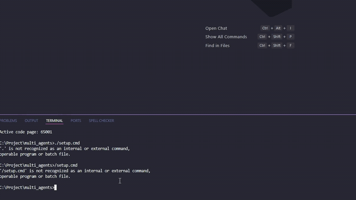
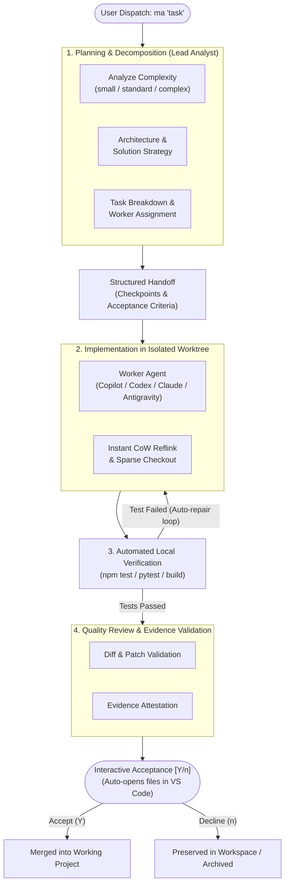
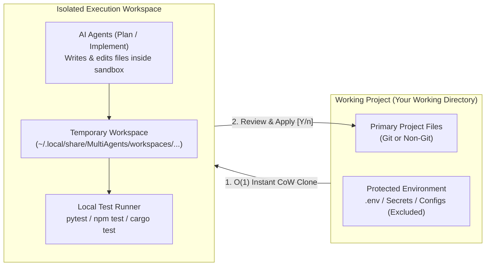

# Multi Agents

**Multi Agents** is a lightweight, local multi-agent orchestrator that coordinates **Antigravity CLI**, **GitHub Copilot CLI**, **OpenAI Codex CLI**, and **Claude Code CLI** for automated planning, implementation, verification, and code review.

- **100% Local & Zero Bloat:** Built purely with Python's standard library (>= 3.11) and Git. No heavy external runtime dependencies.
- **Isolated Worktrees:** All agent modifications occur inside an isolated, detached Git worktree; your active project files remain untouched until you explicitly accept changes.
- **Automated Verification:** Runs your project's local test suite (`npm test`, `pytest`, etc.) automatically before delivery.
- **Failover Resilience:** Automatically fails over to an alternate available agent if one hits a quota exhaustion, timeout, or error.

---

## Demo

<p align="center">
  
</p>

---

## Architecture & Multi-Agent Lifecycle

Multi Agents coordinates role-based agents through an automated planning, implementation, verification, and quality review pipeline with automated self-healing loops:



---

## Workspace Isolation & Safety Boundary

Your primary working directory is never touched directly during agent execution. All code generation, editing, and test runs take place inside detached, isolated sandboxes:



---

### 3-Step Quick Start (1 Minute)

#### Step 1: Install once

Clone the repository and run the setup script:

**Windows (PowerShell or Command Prompt):**

```powershell
git clone https://github.com/khang1604/multi_agents.git
cd multi_agents
.\setup.ps1
# Or double-click setup.cmd
```

**Linux / macOS:**

```bash
git clone https://github.com/khang1604/multi_agents.git
cd multi_agents
./setup.sh
```

_The setup script automatically configures your `PATH` and creates launcher shims. Open a new terminal window to start using `ma`._

#### Step 2: Dispatch a task in any project

Navigate to any project directory (Git or non-Git) and run your task directly:

```bash
cd /path/to/your-project
ma "Add user profile page with avatar upload and automated tests"
```

#### Step 3: Accept verified changes

1. Multi Agents coordinates the specialized agents:
   - **Planner** (e.g., Antigravity) analyzes requirements and builds the technical roadmap.
   - **Worker** (e.g., Copilot / Codex / Claude) writes the code.
   - **Verifier** automatically runs your local test suite (`Tests: X/X passed`).
2. When completed, your modified files are automatically opened in VS Code for review, and the CLI prompts:
   ```text
   Opened workspace files in editor for review (app.js, index.html).

   Apply 2 changed file(s) to project now? [Y/n]: y
   ```
   _(Or run `ma accept` anytime)_. The verified changes are instantly merged into your working directory!

---

### Common Scenarios & How-To

- **Inspect code while the agent is typing:**
  Run `ma open` to open the agent's live temporary workspace in VS Code.
- **Review changes before accepting:**
  Run `ma diff` to inspect the full Git patch of generated code.
- **When status shows `Needs review`:**
  If changes are extensive, Multi Agents avoids consuming excess AI tokens and pauses safely for your inspection. Run `ma diff` to inspect, then `ma accept` to apply.
- **Provider quota exhaustion or network timeout:**
  - `ma agents reset`: Clears cooldown penalties for all agents.
  - `ma retry`: Resumes the paused workflow immediately.
- **Check system health:**
  Run `ma doctor` to verify Python, Git, and installed agent CLIs.

---

### CLI Command Reference

_All commands automatically target the latest workflow if no `[workflow_id]` is provided._

| Command                       | Description                                                                  |
| ----------------------------- | ---------------------------------------------------------------------------- |
| **`ma "<prompt>"`**           | Dispatch a new task, watch live execution, and interactively accept results. |
| **`ma status`**               | Display current workflow state, active agent, and modified files.            |
| **`ma watch`**                | Follow live progress in real time.                                           |
| **`ma open [file]`**          | Open the isolated worktree or a specific file in VS Code.                    |
| **`ma diff`**                 | Print the unified Git patch of all pending changes.                          |
| **`ma accept`**               | Apply completed, verified changes to your working project.                   |
| **`ma accept --file <path>`** | Selectively apply specific files only.                                       |
| **`ma auto-accept on / off`** | Toggle automatic acceptance upon successful test verification.               |
| **`ma retry`**                | Immediately resume a paused, waiting, or failed workflow.                    |
| **`ma cancel`**               | Safely cancel the running workflow while preserving progress checkpoints.    |
| **`ma agents list`**          | List all configured AI CLI providers and their readiness status.             |
| **`ma agents reset`**         | Clear cooldown locks for all providers (or a specific provider).             |
| **`ma doctor`**               | Diagnose system setup, Python version, Git path, and agent availability.     |
| **`ma setup`**                | Open interactive CLI configuration dashboard.                                |

---

### VS Code Copilot Chat (`@hub`) Integration

If you enabled the VS Code Chat Participant during setup:

| Command        | Action                                                                   |
| -------------- | ------------------------------------------------------------------------ |
| `@hub <task>`  | Dispatch a task directly from VS Code chat (e.g. `@hub Add unit tests`). |
| `@hub /status` | Check current workflow state and agent milestones.                       |
| `@hub /watch`  | Stream live task execution inside the chat pane.                         |
| `@hub /accept` | Apply verified changes with one click.                                   |
| `@hub /retry`  | Resume a waiting or failed workflow.                                     |
| `@hub /agents` | View status of installed agent CLIs.                                     |

---

## Disclaimer

- **Independent Project:** Multi Agents is an independent open-source project and is not affiliated, endorsed, sponsored, or certified by Google, OpenAI, Anthropic, or GitHub/Microsoft. All product names, logos, brands, CLI names, and trademarks mentioned are the property of their respective owners.
- **AI-Generated Code & Verification:** Multi Agents autonomously coordinates AI models to read, generate, and modify source code. AI-generated code may contain errors, logical bugs, or security vulnerabilities. Users must review all proposed changes before accepting (`accept`) them into their codebase.
- **Quota & API Costs:** Users are solely responsible for managing their own API quotas, token limits, and any operational costs incurred by connected AI CLI tools and providers.
- **Data Safety:** Do not use this tool on sensitive production repositories, credentials, secrets, private keys, or non-isolated production environments.

---

## License & Contributions

This project is licensed under the [MIT License](LICENSE). Contributions, bug reports, and suggestions are welcome! Please feel free to open an Issue or Pull Request on GitHub: [khang1604/multi_agents](https://github.com/khang1604/multi_agents).
