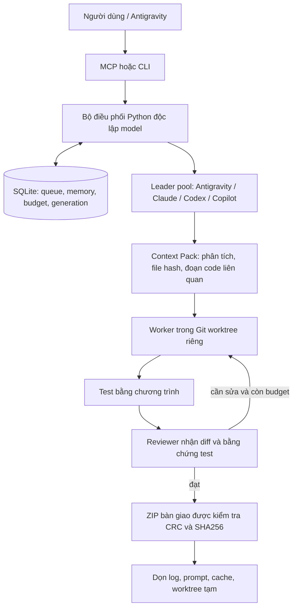

# Kiến trúc Agent Hub Private

## V2 extension boundary

`ma.py -> agenthub/cli.py` là entrypoint mới, dùng chung `Hub`, `Store`, `Engine` và
MCP với `hub.py`. Không có orchestrator thứ hai cho từng IDE/client. `settings.py`
chọn home ngoài repo; `registry.py` chỉ probe command chính thức, không đọc credential.
`project_context.py` lưu version/hash và fact/suy luận riêng ở home/projects/<id>.
`wizard.py`, `integrations.py`, `lifecycle.py`, `monitor.py` lần lượt quản lý setup,
client stdio, ownership PATH/migration và view từ event thật. Vẫn chỉ standard library.

Một SQLite trung tâm tiếp tục là nguồn workflow/memory/checkpoint, thay vì tạo nhiều
DB không nhất quán cho từng client. Các project settings/context ở thư mục riêng,
id được lưu ổn định theo path đăng ký. Worktree và delivery ở home ngoài source.
Global enabled=false không thể bị project override tự bật lại. Cấu hình provider
bị khóa khi có workflow active; daemon nạp lại giữa các step, không ngắt writer.

Worker CLI nhận marker môi trường; Hub từ chối dispatch đệ quy từ marker đó. Client
provenance chỉ là metadata, không cấp quyền. Request key vẫn chống giao task trùng.
MCP thay đổi enabled/model cần permission riêng, mặc định false. MCP init chỉ refresh
project đã được đăng ký bằng CLI; không cho client chọn đường dẫn tùy ý.

Default sửa tối đa 3 vòng ở policy standard/complex mới, nhưng CLI call cap vẫn cứng
và config cũ giữ nguyên giá trị. Self-review được ghi event và independent_provider=false.
Lỗi model chỉ chuyển Provider Default khi operator đã chọn fallback INHERIT, lưu event
theo workflow và tính trong call cap; không thay model config hoặc model trong IDE.

## Mô hình

## Điều phối và failover

Daemon không phải agent LLM. Nó chỉ gọi model tại các bước plan/implement/review.
SQLite là nguồn trạng thái duy nhất. FileLock dùng flock trên Unix, msvcrt trên Windows
đảm bảo một daemon sở hữu data directory. Một project chỉ có một workflow active.

Mỗi lượt có generation. Cancel tăng generation, khiến kết quả đang chạy cũ không thể ghi
đè trạng thái mới. Trước failover, worker phải kết thúc hoặc được dừng cả cây tiến trình.
Nếu không xác nhận an toàn, hệ thống dừng; sau hard crash mà child còn sống, nó chờ
ở recovering. Đây là cơ chế cho một máy cá nhân, không phải distributed leader election.

Leader hoạt động khi có một quyết định cần làm, không được gọi/ping định kỳ chỉ để kiểm tra.
Leader mới nhận cùng objective, kế hoạch, handoff và checkpoint, không khởi động lại dự án.
Cửa sổ context riêng của model không được sao chép nguyên trạng.

## Context Pack

Gói bàn giao gồm prior analysis, quyết định, file map tên-only, file/range liên quan với SHA256,
plan, diff và bằng chứng test. Caller Antigravity có thể gửi prepared_plan + handoff;
planner bên trong phải trả context_files để worker không khám phá lại toàn repository.

Mặc định chỉ chọn 4 file ứng viên cộng root instructions/README; ưu tiên file do leader chỉ định.
Mỗi file chỉ gửi tối đa 160 dòng mặc định; có thể chỉ định phạm vi tối đa 301 dòng.
Reviewer không nhận lại toàn bộ source: chỉ analysis + plan + diff + verification.
Nếu thiếu thông tin, agent phải đọc thêm đúng phần cần hoặc báo blocked, không được đoán.

Cache cục bộ khóa theo absolute path, mtime_ns, size và SHA256. File không đổi tái sử dụng hash;
chỉ file được đưa vào Context Pack mới lưu text. Hashing/file indexing local không dùng model.
Mỗi lượt lưu context-pack.json và context_chars trong usage. Đây là số ký tự ngữ cảnh,
không phải token hóa chính xác của provider. Metadata cache tin cậy filesystem/Git cục bộ;
không được coi là cơ chế chống đối thủ cố tình giữ nguyên size/mtime khi sửa file.

Các prompt yêu cầu không scan lại toàn repository. Đây là hướng dẫn hành vi, không phải
cơ chế bảo đảm tuyệt đối model không đọc lại; worker vẫn có thể cần đọc file mục tiêu để sửa
chính xác. Tối ưu là tránh lặp lại toàn bộ khám phá và gửi dư code, không loại bỏ mọi lần đọc.

## Ngân sách

Auto dùng quy tắc local, planner có thể nâng độ phức tạp. Mức trần không tự tăng.
Retries/failover cũng tính vào lượt CLI. CLI riêng có thể thực hiện nhiều model requests;
Hub không tuyên bố chặn token/USD tuyệt đối. Lưu usage khi được provider báo.
Test fail → worker sửa trước, chưa gọi reviewer. Có prepared_plan → bỏ lượt planner.

## State machine

queued → plan → implement → verify → review → completed.
Việc nhỏ bắt đầu implement rồi verify, không AI review.
Lỗi tạm thời khi không còn provider khác → waiting; lỗi cần can thiệp → blocked.
Thiếu review hoặc hết vòng sửa → needs_review. Cancel → cancelled, generation tăng.
Chỉ completed mới được tự bàn giao và dọn worktree. Không tự merge code vào repo gốc.
